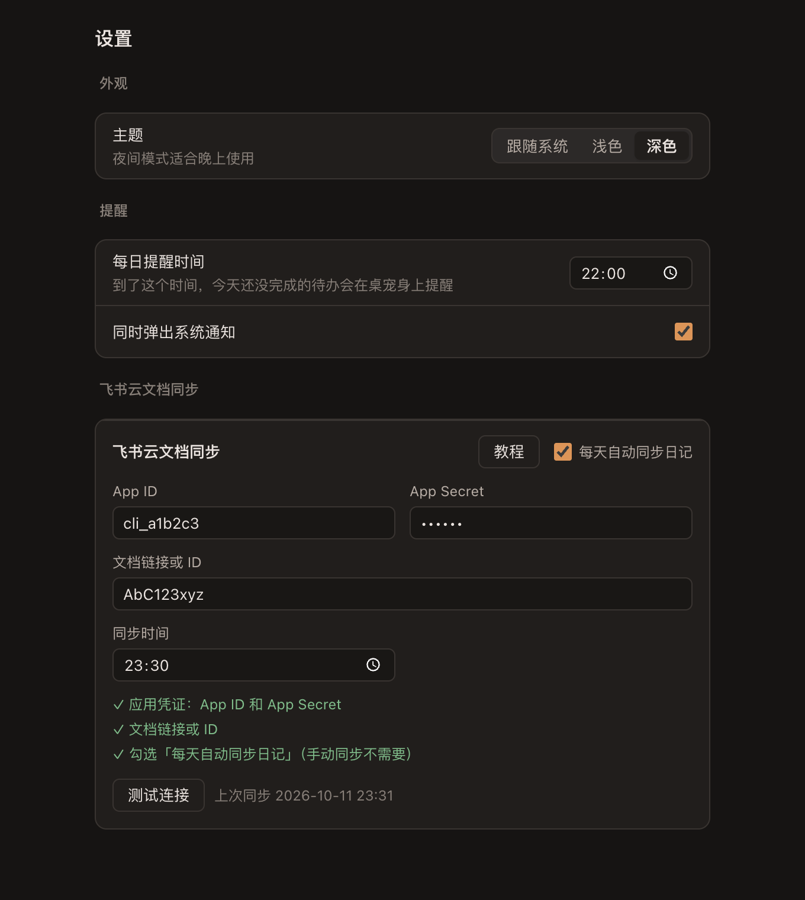

# 自律猫

<p align="center">
  
</p>

<p align="center">
  一只住在桌面上的橘猫，陪你做日常、写日记、经营人际关系、拆解目标。<br />
  支持 macOS 与 Windows，数据只保存在本机。
</p>

<p align="center">
  
  
  
</p>

---

## 简介

自律猫是一款桌面端的自我管理工具。它的核心形态是一只桌宠猫：常驻在桌面角落，到了你设定的时间，如果今天还有没完成的待办，它会冒泡提醒你。点击猫即可打开面板，里面包含四个模块：

- **日常**：按天管理待办，未完成的事项会自动顺延；附带 Markdown 日记，可同步到飞书云文档。
- **社交**：记录认识的人，按照固定的节奏提醒你保持联系。
- **目标**：按周、月、年、远期四个维度设定目标，每个目标都可以写下「为什么」和「怎么做」。
- **设置**：外观（跟随系统 / 浅色 / 深色）、提醒时间、飞书同步。

本项目不依赖任何账号，也没有云端服务。所有数据都保存在你自己的电脑上，只有在你主动开启飞书同步时，日记才会发送到你自己的飞书文档。

## 截图

| 目标（浅色） | 目标（深色） |
| --- | --- |
|  |  |

| 设置（深色） |
| --- |
|  |

## 功能

### 桌宠

- 猫常驻桌面，按住可以随意拖动位置。
- 鼠标悬停时猫会眯眼跳动，点击打开面板。
- 右键菜单：打开面板、退出。
- 每日提醒时，猫身上会弹出气泡，显示今天还剩几件待办没完成。

### 日常

- **日历**：点击某一天，即可查看和编辑当天的待办。勾选即完成。
- **顺延**：未完成的待办会自动移到第二天，并标注「顺延自 MM-DD」，不会悄悄丢失。
- **快速定位**：日历标题可点击，先选年份，再选月份，无需一个月一个月地翻。
- **今日日记**：实时渲染的 Markdown 编辑器，输入即预览，支持标题、列表、任务列表、代码块等 GFM 语法。

### 社交

- 录入认识的人时可以选择「认识日期」（默认今天，不能选未来的日期）。认识当天算作第一次联络。
- 联络间隔依次为：3 天 → 7 天 → 15 天 → 30 天；之后固定每 30 天提醒一次。
- 每次点击「已联络」都会记录一条日志，并自动计算下一次提醒的日期。
- 「今日需联络」列表会列出所有到期的人，不设上限。

### 目标

- **周目标**：以周为单位，左侧选择周次，右侧查看和编辑。
- **月目标 / 年目标**：从日历上选中月份，或直接点击「年目标」。
- **远期目标**：几年之后想成为什么样的人，不绑定具体时间。
- 每个目标包含标题、为什么、怎么做三部分，可以勾选完成。

### 提醒

- 可以设置每日提醒时间（默认 22:00）。
- 到点后，猫身上会弹出气泡；如果开启了系统通知，也会同时弹出系统通知。
- 每天只提醒一次。

### 飞书云文档同步

自律猫可以把你写的日记同步到飞书云文档，方便在手机或其他设备上查看。

- 开启「每天自动同步日记」后，日记会在你设定的同步时间（默认 23:30）自动同步。也可以随时在日记下方手动同步今天的日记。
- 同一天的日记只会同步一次。同步前会弹出确认，提醒你今天的日记已经写完，同步后的修改不会再写入飞书。
- 开启同步的那一天会被记录为起始日期，之前写的日记不会被一次性导入。
- 设置中内置了教程，告诉你如何在飞书开放平台创建应用、获取 App ID 与 App Secret、以及找到文档链接。

> 飞书同步需要你自己的飞书应用凭证。App Secret 只保存在你本机的数据文件里，不会上传到任何地方。

## 下载与安装

前往 [Releases](https://github.com/zenia-liu/zilu-cat/releases) 页面下载对应系统的安装包：

- **macOS**：下载 `.dmg` 文件，打开后将「自律猫」拖入「应用程序」。
- **Windows**：下载 `.exe` 安装程序，按提示完成安装。

> 目前的安装包没有经过代码签名。首次打开时系统可能会拦截，这是正常现象，请按下面的方法放行：
>
> - **macOS**：提示「无法打开，因为无法验证开发者」时，在「应用程序」中右键点击自律猫 → 「打开」。如果仍然被拦截，请前往「系统设置 → 隐私与安全性」，在底部点击「仍要打开」。
> - **Windows**：SmartScreen 弹出「Windows 已保护你的电脑」时，点击「更多信息」→「仍要运行」。

## 数据位置

所有数据保存在一个 JSON 文件中，你可以随时备份或迁移。

- **macOS**：`~/Library/Application Support/自律猫/data.json`
- **Windows**：`%APPDATA%\自律猫\data.json`

## 从源码运行

### 环境要求

- Node.js（建议使用当前的 LTS 版本）
- npm（随 Node.js 一起安装）

### 安装与运行

```bash
git clone https://github.com/zenia-liu/zilu-cat.git
cd zilu-cat
npm install
npm run dev
```

`npm run dev` 会启动开发模式，桌面右下角会出现猫。

### 常用命令

| 命令 | 说明 |
| --- | --- |
| `npm run dev` | 开发模式运行 |
| `npm run build` | 构建到 `out/` 目录 |
| `npm run typecheck` | TypeScript 类型检查 |
| `npm test` | 运行共享逻辑的单元测试（日期、联络间隔、待办顺延、提醒条件等） |

## 技术栈

- [Electron](https://www.electronjs.org/) 与 [electron-vite](https://electron-vite.org/)
- [React 19](https://react.dev/) 与 TypeScript
- [CodeMirror 6](https://codemirror.net/)，用于日记的实时 Markdown 编辑
- [Vitest](https://vitest.dev/)，用于单元测试

## 项目结构

```
src/
  shared/      共享的类型定义、纯逻辑（含单元测试）、IPC 常量、飞书相关的纯函数
  main/        主进程：数据存储、窗口管理、每日提醒调度、飞书同步
  preload/     预加载脚本，通过 contextBridge 向页面暴露 window.api
  renderer/
    pet/       桌宠（猫的 SVG 图形与交互）
    panel/     面板：日常、社交、目标
    settings/  设置窗口
docs/
  screenshots/ README 中使用的截图
```

## 隐私

- 不收集任何使用数据，不需要注册账号。
- 不包含任何统计、广告或第三方追踪代码。
- 网络请求只有一种情况：你开启飞书同步之后，日记内容会发送到飞书开放平台的接口。
- 应用内打开的外部链接仅限飞书开放平台（`https://open.feishu.cn/`）。

## 路线图

- [ ] 应用签名与公证，降低安装时的系统警告
- [ ] 应用内自动更新
- [ ] 数据导出与导入

欢迎通过 Issue 提出建议或反馈问题。

## 许可证

本项目基于 [MIT License](LICENSE) 开源。

Copyright (c) 2026 Zenia Liu
